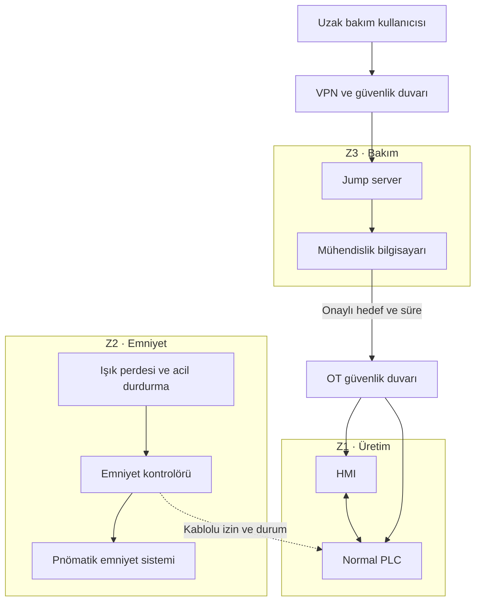

# Ağ mimarisi

[Makine projesine dön](../README.md)

Hedef mimaride üretim, emniyet ve bakım üç ayrı bölge olarak ele alınır. Uzak bakım, yerel yetkilinin onayıyla açılan bir tasarım özelliğidir

Z2 kontrolörünün ağ üzerinden programlama bağlantısı hedef tasarımda kapalıdır. Yerel emniyet programlama ihtiyacı üretim durdurulmuşken ayrı onayla karşılanır. Normal PLC, emniyet iznini okuyabilir. Bu izin normal program tarafından geçersiz kılınamaz

VPN ve OT filtreleme işlevleri tek bir çok arayüzlü endüstriyel güvenlik duvarında veya iki cihazda uygulanabilir. Şema işlevleri gösterir. Ağ cihazı modeli ve protokol seçimi kurulum öncesi karardır

Saha sensörleri ve valflerin kabloları PLC giriş/çıkış bağlantılarıdır. Kablosuz ağ ve bulut bağlantısı bu proje kapsamında bulunmaz

[İzinli bağlantılar](../05-zone-conduit/README.md) · [Uzak erişim işlemi](../06-uzak-erisim/README.md)
