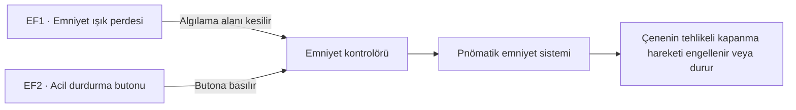

# Poşet Isıl Yapıştırma Makinesi — Makine Emniyeti

Bu belge, ders projesi için tasarlanan yarı otomatik pnömatik poşet ısıl yapıştırma makinesinin ön emniyet tasarımını açıklar. Operatör poşeti elle yerleştirir ve çevrimi başlatır. PLC çenenin kapanması, yapıştırma, soğutma ve açılma adımlarını yönetir. Tehlike senaryoları, [SWOT analizinde](../SWOT_Analizi.md) belirlenen elle besleme koşulundan yola çıkar.

## Tehlikeler ve önlemler

| No | Çalışma adımı ve tehlikeli durum | Olası zarar | Önerilen önlem |
| --- | --- | --- | --- |
| H1 | Operatör poşeti yerleştirirken eli çenelerin arasındadır ve kapanma başlar. | Parmakların sıkışması veya ezilmesi | Girişte emniyet ışık perdesi ve çenenin kapanmasını engelleyen veya durduran emniyet fonksiyonu (EF1) |
| H2 | Operatör poşeti alırken açık durumdaki sıcak çeneye temas eder. | El veya parmak yanığı | Poşetin geçebildiği ve operatörün sıcak yüzeye erişimini engelleyen sabit koruyucu |
| H3 | Sıkışan poşeti çıkarmak için çene bölgesine erişmek gerekir. Beklenmedik bir başlatma veya devrede kalan basınç çeneyi hareket ettirebilir. | Elin sıkışması veya ezilmesi | Müdahale öncesi elektrik ve basınçlı hava kaynaklarının kilitlenerek yalıtılması ve kalan enerjinin güvenli duruma getirilmesi |

## Emniyet fonksiyon haritası

| Fonksiyon | Tasarımda istenen davranış | Doğrulama için örnek koşul |
| --- | --- | --- |
| **EF1 — Çene kapanmasının engellenmesi veya durdurulması** | Algılama alanı kesildiğinde açık çene kapanmaz. Çene kapanıyorsa hareket, el tehlike bölgesine ulaşmadan durmalıdır. Kapanma durdurulduktan sonra alanın tekrar açılmasıyla hareket kendiliğinden başlamaz. Bölge kontrol edildikten sonra emniyet fonksiyonu sıfırlanır ve yeni bir başlatma komutu verilir. | Algılama alanını çevrim başlatılmadan önce ve kapanma sırasında kesme senaryoları incelenir. Emniyet mesafesi, ölçülen toplam durma süresine göre doğrulanır. |
| **EF2 — Acil durdurma** | Operatör butona bastığında tehlikeli hareket durdurulur ve yeni çevrim engellenir. Buton serbest bırakılana kadar durdurma talebi etkin kalır. Serbest bırakmanın ardından diğer emniyet koşulları sağlandığında yeniden başlatma için ayrı bir başlatma komutu gerekir. | Kapanma sırasında butona basılması ve ardından butonun serbest bırakılması senaryosunda çenenin kendiliğinden hareket etmediği kontrol edilir. |

Normal PLC çevrimi yönetir. Emniyet kontrolörü, normal PLC'den kapanma komutu gelse bile emniyet koşulları sağlanmadığında bu harekete izin vermez. Pnömatik durdurma yönteminin seçimi, silindir ve çenenin basınç değişimindeki davranışı incelendikten sonra yapılacaktır.

## Sıcak yüzey ve sıkışan poşete müdahale

- **H2 — Sabit koruyucu.** Poşet yerleştirilip alınırken açıklıktan veya koruyucunun çevresinden sıcak çeneye erişim olasılığı tasarım üzerinden kontrol edilir. Çene açık ve hareketsizken yüzey hâlâ sıcak olabilir.
- **H3 — Enerji yalıtımı (Lockout/Tagout).** Bölgeye erişim gerekiyorsa yetkili kişi elektrik ve basınçlı hava kaynaklarını yalıtır, yalıtım noktalarını kilitler ve etiketler. Kalan basınç, çenenin beklenmedik hareketini önleyecek şekilde güvenli duruma getirilir. Müdahale öncesinde yalıtımın etkili olduğu, çenenin hareket edemeyeceği ve sıcak yüzey riskinin giderildiği doğrulanır.

## Kaynaklar

- [OSHA · Machine Guarding — Devices](https://www.osha.gov/etools/machine-guarding/introduction/devices)
- [SICK · deTec4 işletim kılavuzu — emniyet ışık perdesi ve yeniden başlatma kilidi](https://www.sick.com/media/docs/1/41/841/operating_instructions_detec4_safety_light_curtain_en_im0079841.pdf)
- [Festo · Guideline for functional safety — pnömatik durdurma işlevleri](https://media.festo.com/media/3034_documentation.pdf)
- [AB 2023/1230 Makine Tüzüğü · Ek III, 1.2.4.3 Acil durdurma](https://eur-lex.europa.eu/eli/reg/2023/1230/oj)
- [HSE · PUWER rehberi — sıcak yüzeylere karşı koruma](https://www.hse.gov.uk/pubns/priced/puwer.pdf)
- [OSHA · The control of hazardous energy — Lockout/Tagout](https://www.osha.gov/laws-regs/regulations/standardnumber/1910/1910.147)

## Hedef tasarıma eklenen ısıl koruma

EF3 kapsamında bağımsız sıcaklık sınırlayıcının, sınır aşıldığında ısıtıcı beslemesini kesmesi önerilir. Normal PLC ayarının değişmesi bu sınırlamayı geçersiz kılamamalıdır. H2 için koruyucu, sıcak yüzeye erişimi engellemeye devam eder

Isıl sınırın değeri, algılayıcı konumu ve gerekli güvenilirlik donanım seçimi ve risk değerlendirmesiyle belirlenecektir. Isıtıcı kesilse de yüzeyin soğuması beklenir. Acil durdurma sonrası ısıtıcı enerjisinin kesilmesi hedef tasarıma dahil edilmiştir

Poşet ve elin algılama alanındaki konumu, sabit koruyucu ve ışık perdesi yerleşimi birlikte doğrulanır. Koruyucu açıklığı erişimi tamamen önlüyorsa ışık perdesinin sağladığı ek koruma yeniden değerlendirilir. Malzeme geçişi gerekçesiyle algılama devre dışı bırakılmaz

Reset, yerel ve tehlike bölgesinin görülebildiği noktada yapılır. Haberleşme kaybı veya güç geri gelmesi yeni çevrimi kendiliğinden başlatmamalıdır

[Test planı](../15-dogrulama-test/README.md) · [Makine tanımı](../README.md)
